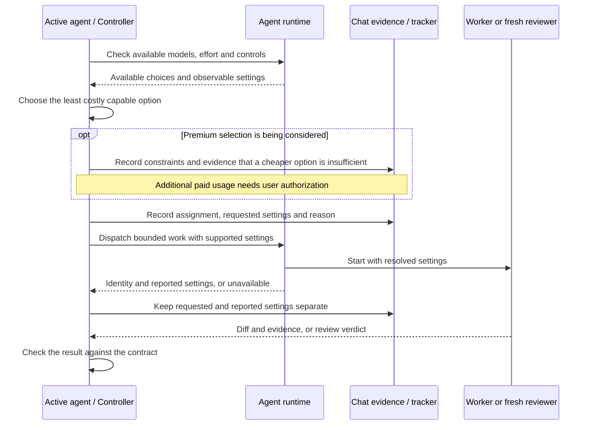

# Model and effort selection

[Back to README](../README.md)

Run the CLI examples from the repository root.

## Start with what the task needs

Choose the least costly available model that can handle the assignment, use an effort level the runtime supports, and check what actually started. The main agent keeps its session settings.

Model choice is separate from workflow mode, execution, risk and quality. A fresh reviewer may use the same model as the worker: HIGH review requires independence, not a stronger model. The shared rules are in [.lean/policy/MODELS.md](../.lean/policy/MODELS.md).

## Documented model options

Available models and effort controls change. Check your account and runtime before dispatch rather than treating a list in this guide as a fixed default.

| Runtime | Where to check | What to confirm |
|---|---|---|
| Codex | [Model documentation](https://learn.chatgpt.com/docs/models) and [subagent settings](https://learn.chatgpt.com/docs/agent-configuration/subagents) | Available model IDs, supported effort and default/inherited settings. |
| Claude | [Subagent model selection](https://code.claude.com/docs/en/sub-agents#choose-a-model) | Supported aliases/full IDs, `inherit` and available invocation controls. |

Runtime availability is the deciding evidence. Public documentation alone cannot show that your account has access. Custom providers may expose additional IDs. Check API-key/provider access separately from ChatGPT sign-in access.

## Choose settings for the assignment

These are starting points from the repository's policy, rather than promises about a named model's price or capability:

| Work | Starting point |
|---|---|
| Mechanical, bounded work | An economical capable model with supported low effort when sufficient. |
| Normal implementation or focused review | The current/default capable model with supported medium effort. |
| Hard reasoning | A capable available model with useful supported high effort. |
| Independent HIGH review | A fresh capable reviewer with settings appropriate to the diff. |

Use capable defaults or inheritance if selection controls are unavailable. If no available option meets the quality floor, report BLOCKED. Recommend a user-controlled session change only when current settings threaten that floor or repeated reasoning failures justify it.

## Dispatch and check the result



Before premium dispatch, record the desired outcome, material constraints and concrete evidence that a cheaper available option cannot satisfy the task. A risk label, preference or claim of complexity alone is not enough. Additional paid usage still needs authorization. A long task by itself is no reason to increase spend.

Requested settings do not prove backend settings. Record runtime-reported model/effort when exposed; otherwise mark them unavailable. Do not claim to change the main session without runtime confirmation, or infer actual settings from the request.

## Claude inheritance

Claude uses the session model and effort selected by the user/runtime. This repository's [reviewer definition](../.claude/agents/reviewer.md) uses `model: inherit` and inherits session effort. A supported, justified per-invocation override can be used without editing that shared definition for one task.

Inheritance still needs a capability check against the task. If the runtime cannot expose or change a setting, state the limitation and assess the available option honestly. An independent reviewer receives the contract and diff without the author's reasoning.

## If the work fails

First identify the cause: implementation, missing context, tools, permissions or a demonstrated reasoning limit. Fix implementation/context/tool/permission problems directly.

For a reasoning limit, raise one supported effort level first if the model remains capable. Consider a stronger model only if still needed, using the same selection and billing guards. Record the reason and change one variable per retry. Review retries stay within the bounded review cycle and keep the requested quality floor.

## Refresh model research without switching models

After enabling optional skills, use `/lean-model-update codex`, `/lean-model-update claude` or `/lean-model-update all`; in Codex, use `$lean-model-update` with the same arguments.

The procedure follows scope → research → grill → preview, checking official docs and exposed runtime choices. It returns a diff and proposal hash by default. Apply needs an explicitly authorized proposal, then the usual task/review/gate checks. It keeps session models, global configuration, billing permissions and reviewer inheritance unchanged.

Optional project-owned `.lean/model-catalog.json` stores model/alias IDs, runtime version, efforts, lifecycle, source URLs/dates and observed availability. Evidence older than 30 days for the selected provider blocks preview/apply. Other retained providers remain visible as stale. Missing catalog leaves ordinary model selection unchanged; the template ships no live catalog.

The offline CLI reads researched JSON candidates. It does not fetch models or run inference. Read the [catalog format](../.lean/skills/lean-model-update/references/catalog.md) before preparing a candidate. Refreshing a provider replaces its complete model list, so review removals and aliases too.

```sh
python3 .lean/scripts/model_catalog.py check
python3 .lean/scripts/model_catalog.py preview --provider codex --candidate /path/to/candidate.json
# Save and review the preview report. Apply only with authorization:
python3 .lean/scripts/model_catalog.py apply --proposal /path/to/report.json --sha256 APPROVED_PROPOSAL_DIGEST
```

Preview/check write nothing. Apply locks and rechecks the base/evidence, preserves other providers and custom fields, and writes atomically. It creates or retains ignored `.agent-runtime/model-catalog.lock`, even if a locked apply is refused. Runtime model settings stay unchanged.

A changed base needs a new preview. An identical retry leaves the catalog unchanged. The digest checks content consistency, not research authenticity. CLI failures exit 2. Tests use synthetic fixtures with no network or paid model calls.
