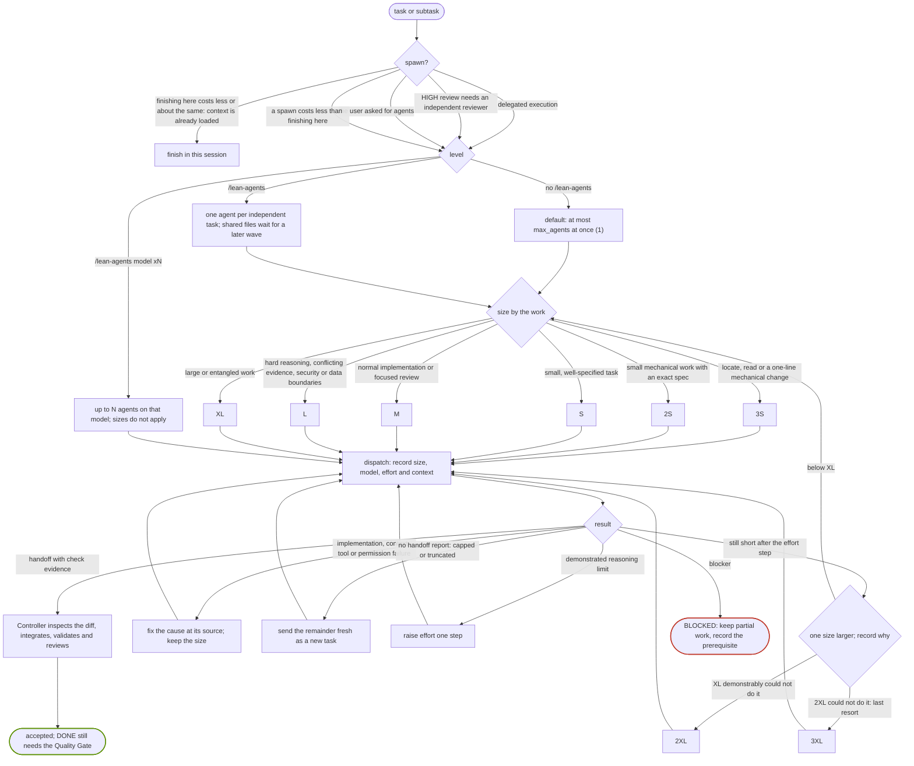
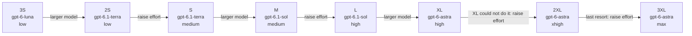

# Spawn map

[Back to README](../README.md)

How Lean decides whether to spawn an agent, how many, at which size, and what happens when one falls short. Each arrow carries the reason for taking it. The rules are in [MODELS.md](../.lean/policy/MODELS.md) and the [lean-agents](../.lean/skills/lean-agents/SKILL.md) procedure; see also [agents and models](agents-and-models.md).

## Overview

Sizes only. The model and effort behind each size come from `.lean/models.json`.

- Task length alone never justifies a larger size, and budget never lowers the quality floor.
- A HIGH reviewer uses the smallest capable size. A wording-only diff may use `S` with a before/after rule map; code, tests, hooks or configuration use the normal size.
- `3S`, `2S`, `2XL` and `3XL` are optional in a project's list. A size the provider does not define is refused, never replaced by another.

## By provider

The shipped `.lean/models.json` (checked 2026-10-27). Your project may differ: `python3 .lean/bin/lean models` prints the current list. Start at the size the work calls for; each arrow is the next step when the agent hits a demonstrated reasoning limit.

> [!IMPORTANT]
> Escalation always stays within one provider, for Claude, Codex and agy alike. Lean never moves a task to another provider, because many users subscribe to only one. When the provider's largest size falls short, the task is `BLOCKED`.

### Claude

```mermaid
flowchart LR
  A["3S<br/>claude-haiku-5-5<br/>low"] -->|"raise effort"| B["2S<br/>claude-haiku-5-5<br/>medium"]
  B -->|"larger model"| C["S<br/>claude-sonnet-5-5<br/>low"]
  C -->|"raise effort"| D["M<br/>claude-sonnet-5-5<br/>medium"]
  D -->|"larger model"| E["L<br/>claude-opus-5-5<br/>high"]
  E -->|"raise effort"| F["XL<br/>claude-opus-5-5<br/>xhigh"]
  F -->|"XL could not do it: larger model"| G["2XL<br/>claude-fable-5-1<br/>high"]
  G -->|"last resort: raise effort"| H["3XL<br/>claude-fable-5-1<br/>max"]
```

### Codex

### agy

agy has no effort setting; the thinking level is part of the model name.

```mermaid
flowchart LR
  A["3S<br/>gemini-3.8-flash-low"] -->|"higher thinking variant"| B["2S<br/>gemini-3.8-flash-medium"]
  B -->|"higher thinking variant"| C["S<br/>gemini-3.8-flash-high"]
  C -->|"larger model"| D["M<br/>gemini-4-argon-low"]
  D -->|"higher thinking variant"| E["L<br/>gemini-4-argon-medium"]
  E -->|"higher thinking variant"| F["XL, 2XL, 3XL<br/>gemini-4-argon-high"]
  F -->|"no larger option in the list"| G(["report BLOCKED"])
```

`2XL` and `3XL` map to the same model as `XL` for agy, so escalating past `XL` changes nothing there. If none of the provider's sizes meets the floor, report `BLOCKED` ([MODELS.md](../.lean/policy/MODELS.md#runtime-control)).