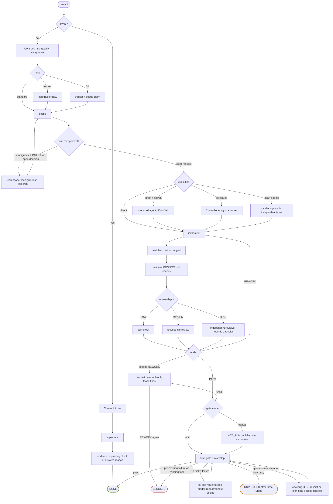

# Workflow map

[Back to README](../README.md)

Every path a task can take through Lean, from the contract to the Quality Gate. The phases are described in the [workflow guide](workflow.md); the rules behind each branch live in the policies linked below.

## Reading the branches

- **Trivial or not.** A task is trivial when risk is `LOW`, the goal is clear, and it touches one file or makes a mechanical edit across a few. Trivial tasks skip scope, trackers and formal review but still need evidence ([WORKFLOW.md](../.lean/policy/WORKFLOW.md#trivial-task)).
- **Mode.** `standard` keeps session records, `tracker` adds one `docs/tracking/TCKNNN.md` per workset, and `full` adds a claimed queue item for each task ([workflow guide](workflow.md)).
- **Approval.** A clear implementation request is approval of its scope. Lean waits only when the request is ambiguous, risk is `HIGH`, a material decision is open, or the scope grows ([lean-scope](../.lean/skills/lean-scope/SKILL.md)).
- **Execution.** `direct` works in the session and spawns at most one sized agent when that costs less; `delegated` makes the active agent a Controller; `/lean-agents` runs parallel agents for independent tasks ([agents and models](agents-and-models.md)).
- **Review depth.** The deeper of risk and quality floor. `HIGH` needs an independent reviewer, never a fork, and only the reviewer records the receipt. A `PASS` ends review; a second `REWORK` gets one last pass with only those fixes, and the task is `BLOCKED` if that pass is also `REWORK` ([REVIEW.md](../.lean/policy/REVIEW.md)).
- **Gate.** `auto` modes run the gate at Stop; `manual` modes report `NOT_RUN` until the user authorizes a run. A busy lock, an unwritable marker or a pending review releases the Stop as `UNVERIFIED`, which is never a pass. Changed gate controls need a covering `HIGH` review or `lean gate accept-controls` with the user's approval ([quality and runtime](quality-and-runtime.md)).

Only the Quality Gate sets `DONE`. `FAILED` is a tracker state for work that cannot continue ([RECOVERY.md](../.lean/policy/RECOVERY.md)).
